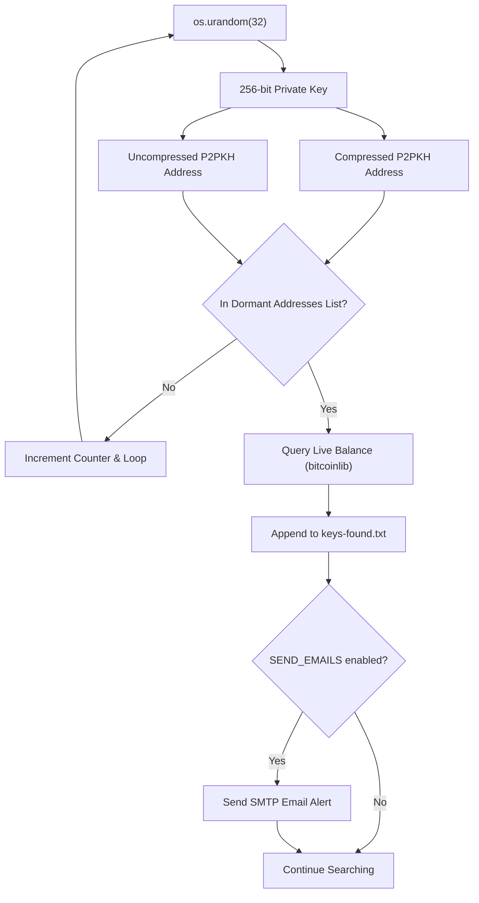

# 🪙 Dormant Bitcoin Hunter

[](https://www.python.org/)
[](https://opensource.org/licenses/MIT)
[](https://github.com/mkhaled87/DormantBitcoinHunter/pulls)

An educational, multi-process Bitcoin private key generator and dormant address hunter written in Python.

**Dormant Bitcoin Hunter** generates random 256-bit Bitcoin private keys, derives both their **compressed and uncompressed** public addresses (legacy P2PKH), and matches them in real time against a target dataset of ~42,400 high-value dormant Bitcoin addresses (derived from early Bitcoin blocks and the [BitInfoCharts Dormant List](https://bitinfocharts.com/top-100-dormant_8y-bitcoin-addresses.html)). If a match is found, it queries the live blockchain balance, writes the key pair to disk, and can optionally dispatch an instant email alert via SMTP.

> This project is inspired by [Henshall/BitcoinPrivateKeyHunter](https://github.com/Henshall/BitcoinPrivateKeyHunter) and [dodiitt/bitcoin_finder_python](https://github.com/dodiitt/bitcoin_finder_python), with enhancements for correctness and multiprocessing throughput.

---

> [!NOTE]
> **Cryptographic Feasibility & The Law of Large Numbers:**
> The Bitcoin private keyspace is $2^{256}$ ($\approx 1.15 \times 10^{77}$ combinations). Even generating tens of thousands of keys per second across multiple machines, the probability of finding a collision with an existing address is astronomically close to zero. This project is created for educational and experimental purposes to explore cryptography, key derivation, and multiprocessing.

---

## ✨ Features

- **High-Performance C Engine:** Powered by Bitcoin Core's native `libsecp256k1` (via `coincurve`), chunked CSPRNG entropy buffering, and pre-compiled 20-byte binary `hash160` lookups, delivering **850,000+ keys/sec** and **1,700,000+ addr/sec** across multi-core systems.
- **Rich Terminal Dashboard (TUI):** Real-time, sticky ANSI terminal interface featuring visual CPU utilization bars, per-core load sparklines, RAM usage, live keys/sec and addr/sec throughput, cycle progress bar, and a live rolling activity ticker.
- **Dual Address Derivation:** Derives both **compressed and uncompressed** public key addresses per generated private key, doubling search coverage against early Bitcoin wallets (2009–2012 era) with virtually zero performance penalty.
- **Multi-Process Concurrency:** Automatically detects and saturates all available CPU cores with minimal inter-process lock contention.
- **Graceful Shutdown & Controls:** Press **`q`** or **`Ctrl+C`** at any point to stop all parallel workers cleanly without tracebacks, restoring terminal state and displaying final metrics.
- **Fast Lookups:** Utilizes $O(1)$ set lookups against 42,000+ dormant addresses.
- **Cryptographically Secure RNG:** Uses Python's `os.urandom(32)` to generate unbiased 256-bit entropy.
- **Balance Verification:** Live balance queries on hits via `bitcoinlib`.
- **Instant Alerts:** Configurable SMTP email notifications with TLS.
- **Continuous Execution:** Included shell and batch scripts for 24/7 background operation.

---

## 🖥️ Terminal Dashboard

When running `hunt.py`, the terminal provides a live, non-scrolling dashboard:

```text
╔════════════════════════════════════════════════════════════════════╗
║                     🪙  DORMANT BITCOIN HUNTER                     ║
╚════════════════════════════════════════════════════════════════════╝

  Status:  ● HUNTING               Workers: 16 processes (libsecp256k1)
  Targets: 42,425 addresses loaded Matches: 0
  Cycle Progress: [███████████░░░░░░░░░░░░] 00:30 / 01:00 (50%)
  Controls: Press [q] or [Ctrl+C] to stop gracefully

  ┌─ SYSTEM UTILIZATION ──────────────────────────────────────────────┐
  │  CPU Usage:  [███████████████████████░]  97.2%                    │
  │  Per-Core:   [████████████████] (16 Cores)                        │
  │  RAM Usage:  [███████████░░░░░░░░░░░░░]  44.8% (56.4G / 128.0G)   │
  └───────────────────────────────────────────────────────────────────┘

  ┌─ SEARCH THROUGHPUT ───────────────────────────────────────────────┐
  │  Keys Rate:        867,360 keys/sec                               │
  │  Address Rate:   1,734,720 addr/sec (compressed + uncompressed)   │
  │  Total Keys:    26,020,800                                        │
  │  Total Addrs:   52,041,600                                        │
  └───────────────────────────────────────────────────────────────────┘

  ┌─ LIVE ACTIVITY SAMPLE ────────────────────────────────────────────┐
  │  Private Key:  ba67e0daa1...87e71700cc                            │
  │  Address (C):  1BLcP3j9Ug5Tf5NfuX1iQt6N6dygvBLCMq                 │
  │  Address (U):  1Kn8AeKFWQWYmqJ6xYyA3Q8bzQvnXwbVS5                 │
  └───────────────────────────────────────────────────────────────────┘
```

---

## 🚀 Quick Start

### 1. Prerequisites
- **Python 3.8+** (tested up to Python 3.13)
- `pip`

### 2. Installation

Clone the repository and set up a virtual environment:

```bash
git clone https://github.com/mkhaled87/DormantBitcoinHunter.git
cd DormantBitcoinHunter

# Create and activate virtual environment
python3 -m venv venv
source venv/bin/activate  # On Windows: venv\Scripts\activate

# Install dependencies
pip install -r requirements.txt
```

### 3. Configuration

Copy the example configuration file:

```bash
cp env.example env.py
```

Edit `env.py` to match your preferences:
- `MAX_SECONDS`: Duration of each hunt cycle before reporting key generation rates.
- `NUM_INSTANCES`: Number of worker processes (`0` = auto-detect all CPU cores).
- `SEND_EMAILS`: Set to `True` if you want email alerts on a match (requires SMTP credentials).

### 4. Running the Hunter

**Single Timed Run:**
```bash
python3 hunt.py
```

**Continuous Mode:**
- **Linux / macOS:**
  ```bash
  chmod +x run_forever.sh
  ./run_forever.sh
  ```
- **Windows:**
  ```cmd
  run_forever.bat
  ```

---

## ⚙️ Configuration Reference

All settings are configured inside `env.py`:

| Parameter | Type | Default | Description |
| :--- | :--- | :--- | :--- |
| `NUM_INSTANCES` | integer | `0` | Number of parallel worker processes (`0` uses all detected CPU cores). |
| `MAX_SECONDS` | integer | `60` | Duration (in seconds) of each execution cycle before printing statistics. |
| `OUT_FILE` | string | `"./keys-found.txt"` | File destination where matched private keys and balances are saved. |
| `SEND_EMAILS` | boolean | `True` | Whether to send an email alert when a match is found. |
| `SEND_TO` | list | `["email@email.com"]` | Recipient email address(es). |
| `SEND_FROM` | string | `"email@email.com"` | Sender email address. |
| `USER` | string | `"email@email.com"` | SMTP username. |
| `PASS` | string | `"password_goes_here"` | SMTP password or app password. |
| `SMTP_HOST` | string | `"my_smtp.host.com"` | SMTP relay server host. |
| `SMTP_PORT` | integer | `587` | SMTP port (typically `587` for STARTTLS). |

---

## 📊 How It Works



---

## ☕ Donations

If you find this project interesting or educational, feel free to support:

- **BTC:** `1MKHALEDqXhBzqa86hj8FbDGW5HvDdA5Tq`
- **ETH:** `0x14551935EDf4aF06909336084412dd805aE14b26`

---

## ⚖️ Disclaimer

This software is provided for educational, research, and entertainment purposes only. The author accepts no responsibility for any misuse, damage, or loss resulting from running or modifying this software.
